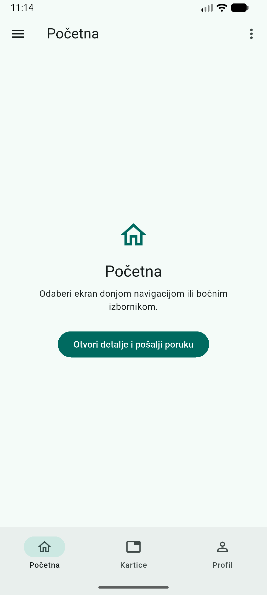

# Navigacija u Flutter aplikaciji

Jednostavna Android aplikacija koja prikazuje donju navigaciju, gornje kartice,
bočni izbornik i padajući izbornik. Poseban ekran pokazuje kako se tekst šalje
drugom ekranu kroz konstruktor.

Glavni kod nalazi se u [lib/main.dart](lib/main.dart). Aplikacija koristi
Flutterove Material komponente. Nisu potrebni korisnički račun, baza podataka
ni dodatni paketi za navigaciju.

**[Tutorial s objašnjenjima koda i slikama](docs/TUTORIAL.md)**



## Priprema

Potrebni su Flutter SDK, Android Studio s Android SDK-om i emulatorom te
uređivač koda, primjerice VS Code s proširenjima Flutter i Dart.

Projekt je provjeren s Flutterom **3.47.7** i Dartom **3.13.5**. U
`pubspec.yaml` naveden je Dart uvjet `^3.13.5`, odnosno najmanje 3.13.5 i manje
od 4.0.0. Flutter uključuje Dart, pa ga nije potrebno zasebno instalirati.

Ako okruženje još nije pripremljeno, slijede se službene upute za
[instalaciju Fluttera](https://docs.flutter.dev/install) i
[Android razvoj](https://docs.flutter.dev/platform-integration/android/setup).

## Pokretanje

1. Preuzmi i raspakiraj projekt ako je u ZIP arhivi.
2. U VS Codeu odaberi **File > Open Folder** i otvori mapu koja sadrži
   `pubspec.yaml`. To je korijenska mapa projekta.
3. Otvori terminal u toj mapi i provjeri okruženje:

   ```sh
   flutter --version
   flutter doctor
   ```

   Za Android moraju biti spremni Flutter i Android toolchain. Nisu potrebni
   alati za Windows desktop razvoj. Ako provjera traži Android licence,
   pokreni `flutter doctor --android-licenses` i dovrši prihvaćanje licenci.

4. U Android Studiju otvori **Device Manager** i pokreni Android virtualni
   uređaj. Na početnom prozoru nalazi se pod **More Actions > Virtual Device
   Manager**, a unutar otvorenog projekta pod **Tools > Device Manager**.
5. Pripremi pakete i provjeri vidi li Flutter emulator:

   ```sh
   flutter pub get
   flutter devices
   ```

6. Pokreni aplikaciju:

   ```sh
   flutter run
   ```

   Ako je dostupno više uređaja, odaberi Android emulator. Uređaj se može
   navesti i naredbom `flutter run -d emulator-5554`, pri čemu se
   `emulator-5554` zamjenjuje stvarnom oznakom iz `flutter devices`.

Nakon pokretanja prikazuje se **Početna**, a pri dnu su **Početna**,
**Kartice** i **Profil**. Prvo pokretanje može potrajati zbog preuzimanja
Android ovisnosti.

## Isprobavanje navigacije

| Radnja | Očekivani rezultat |
| --- | --- |
| U donjoj traci odaberi Profil, zatim Početnu. | Mijenjaju se glavni sadržaj, naslov i označeno odredište. |
| Odaberi Kartice pa Primjer i Opis. | Mijenja se sadržaj unutar ekrana Kartice. Radi i povlačenje lijevo/desno. |
| Otvori gumb s tri vodoravne crte i odaberi Početnu. | Bočni izbornik se zatvara i prikazuje Početnu. |
| Otvori tri okomite točke pa O aplikaciji. | Otvara se ekran Detalji s tekstom „Jednostavan Flutter primjer.” |
| Vrati se na Početnu i pritisni Otvori detalje i pošalji poruku. | Na Detaljima piše „Pozdrav s početne!” |
| Na Detaljima pritisni strelicu za povratak. | Ponovno se prikazuje prethodni ekran. |

Odaberi i karticu **Primjer**, prijeđi na **Profil** pa natrag na **Kartice**.
Primjer ostaje odabran jer `IndexedStack` zadržava stanje sadržaja. Nakon
potpunog ponovnog pokretanja aplikacije odabiri se vraćaju na početne
vrijednosti.

## Datoteke projekta

| Putanja | Sadržaj |
| --- | --- |
| [lib/main.dart](lib/main.dart) | Cijela Flutter aplikacija. |
| [docs/TUTORIAL.md](docs/TUTORIAL.md) | Postupno objašnjenje widgeta, navigacije, prijenosa podataka i dizajna. |
| [docs/slike](docs/slike) | Slike sučelja korištene u dokumentaciji. |
| [test/navigation_test.dart](test/navigation_test.dart) | Dva widget-testa za navigaciju i prikaz. |
| [android](android) | Android konfiguracija i resursi aplikacije. |
| [pubspec.yaml](pubspec.yaml) | Verzija projekta, SDK uvjet i ovisnosti. |

## Provjera koda i ponašanja

Iz korijenske mape projekta pokreću se:

```sh
flutter analyze
flutter test
```

Prvi test provjerava navigaciju, predanu poruku, povratak, zatvaranje bočnog
izbornika i očuvanje kartice. Drugi provjerava početni ekran i ekran Kartice
na zaslonu 320 × 640 uz dvostruko povećanje teksta. Widget-testovi provjeravaju
Flutter sučelje bez zasebnog pokretanja Android emulatora.

Primjer je također pokrenut na Android emulatoru **Medium Phone, API 37.0**.
Slike `pocetna-android.png` i `detalji-android.png` snimke su tog emulatora.
Preostale slike u tutorialu prikazuju Flutter sučelje renderirano u testnom
okruženju. Time je jasno označeno podrijetlo slika.

## Ako se aplikacija ne pokrene

- Ako terminal ne prepoznaje `flutter`, dodaj mapu `bin` instaliranog Flutter
  SDK-a u PATH i ponovno otvori terminal. U VS Codeu može se odabrati SDK
  naredbom **Flutter: Change SDK**.
- Ako nema Android uređaja u `flutter devices`, pričekaj da se emulator
  pokrene i ponovi provjeru. Ako se emulator ne pokreće, provjeri njegovu
  konfiguraciju u Device Manageru.
- Ako postoji problem s SDK-om ili licencama, slijedi nalaz `flutter doctor`.
- Ako Dart verzija ne zadovoljava `^3.13.5`, koristi odgovarajući Flutter SDK
  i ponovno pokreni `flutter pub get`.

Objašnjenja pojedinih komponenti i izvori nalaze se u
[tutorialu](docs/TUTORIAL.md).
