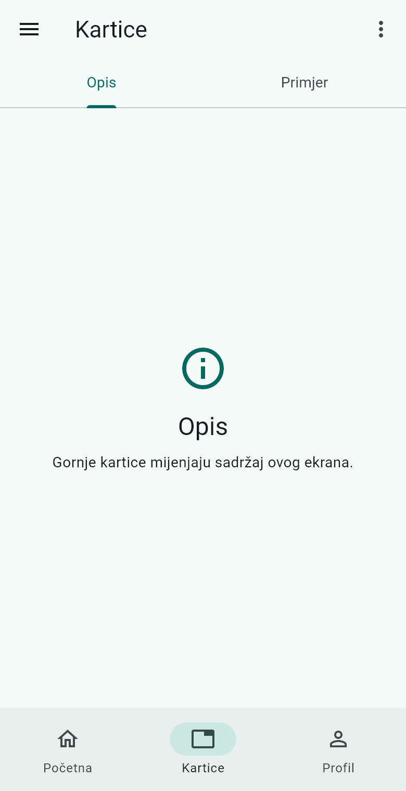
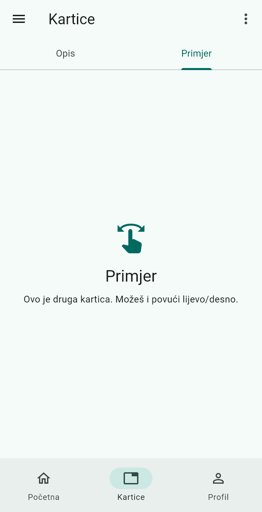
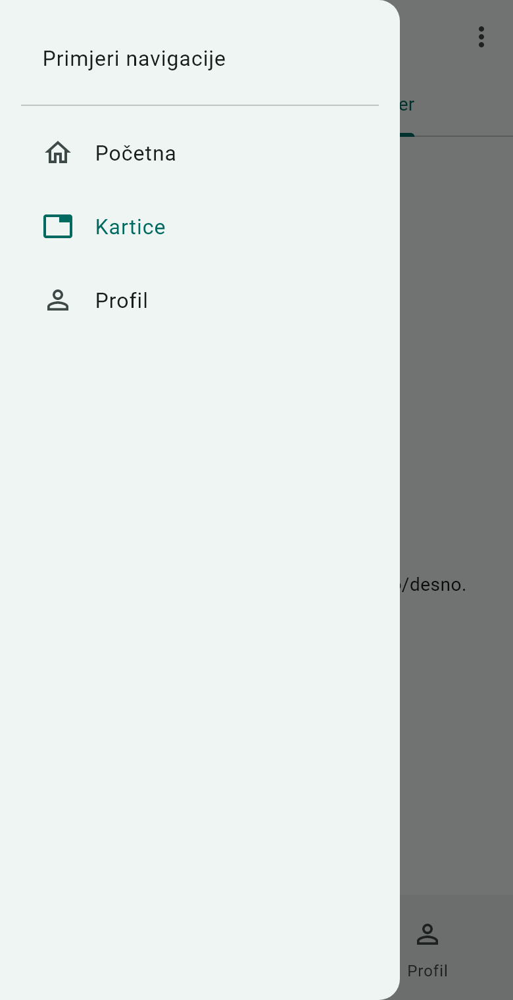
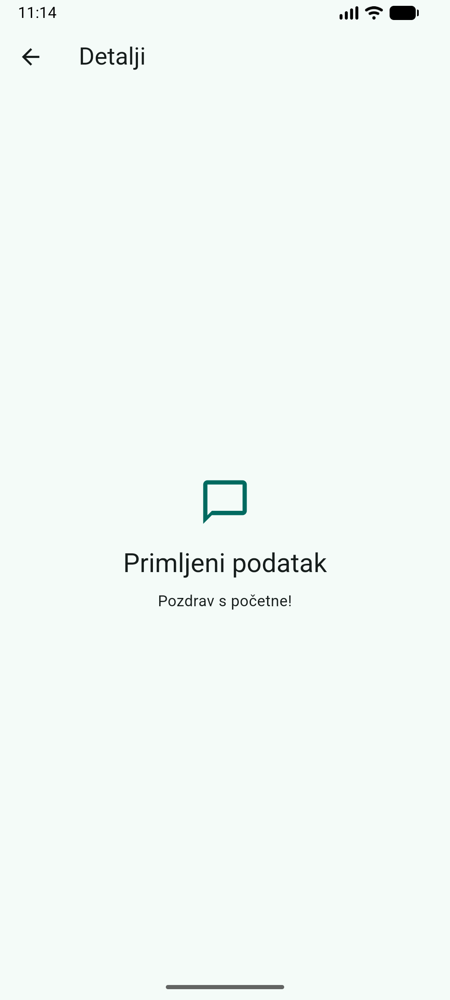
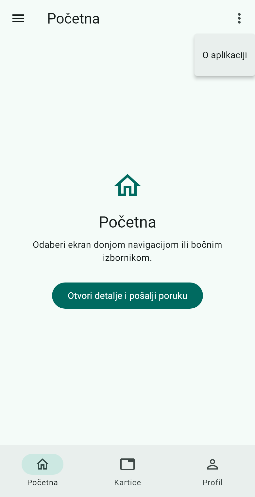

# Tutorial: navigacija u Flutter aplikaciji

Ovaj postupak prati postojeći projekt od početnog ekrana do slanja podatka
drugom ekranu. Cilj je razumjeti što radi svaka vrsta navigacije i kako se
izgled povezuje s kodom.

Prije početka pokreni projekt prema [uputama u README-u](../README.md).
Zatim otvori [lib/main.dart](../lib/main.dart). Svi Dart isječci u nastavku
preuzeti su iz te datoteke. To su dijelovi istog programa; svojstva poput
`body` i `drawer` nalaze se unutar `Scaffolda` i ne pokreću se samostalno.

## 1. Početak aplikacije

```dart
import 'package:flutter/material.dart';

void main() => runApp(const NavigacijaApp());

class NavigacijaApp extends StatelessWidget {
  const NavigacijaApp({super.key});

  @override
  Widget build(BuildContext context) => MaterialApp(
    debugShowCheckedModeBanner: false,
    title: 'Primjeri navigacije',
    theme: ThemeData(
      colorScheme: ColorScheme.fromSeed(seedColor: Colors.teal),
      useMaterial3: true,
    ),
    home: const GlavniEkran(),
  );
}
```

`material.dart` daje pristup Material widgetima, primjerice `Scaffoldu`,
`AppBaru` i navigacijskim komponentama. Funkcija `main` pokreće aplikaciju
pozivom `runApp`. Naš widget `NavigacijaApp` vraća `MaterialApp`, koji postavlja
temu i početni ekran. U svojstvu `home` naveden je `GlavniEkran`.

`ThemeData` uključuje Material 3, a `ColorScheme.fromSeed` stvara paletu boja
iz zadane tirkizne boje. Time svi dijelovi aplikacije koriste usklađenu temu.

**Provjera:** nakon pokretanja treba se prikazati ekran Početna s donjom
navigacijom, gumbom bočnog izbornika i trima točkama u gornjoj traci.

## 2. Dio sučelja kao vlastiti widget

Widget opisuje dio Flutter sučelja. Može biti običan tekst ili gumb, ali i
skup elemenata ili cijeli ekran. Podjelu sučelja na manje cjeline u ovom
projektu ostvarujemo zasebnim widgetima. Ne koristimo Androidovu klasu
`Fragment`, koja pripada drugom načinu razvoja Android sučelja.

Na kraju `main.dart` nalazi se naš widget `Sadrzaj`:

```dart
class Sadrzaj extends StatelessWidget {
  const Sadrzaj({
    super.key,
    required this.naslov,
    required this.tekst,
    required this.ikona,
    this.gumb,
  });
  final String naslov;
  final String tekst;
  final IconData ikona;
  final Widget? gumb;

  @override
  Widget build(BuildContext context) => Center(
    child: SingleChildScrollView(
      padding: const EdgeInsets.all(24),
      child: Column(
        mainAxisSize: MainAxisSize.min,
        children: [
          Icon(ikona, size: 48, color: Theme.of(context).colorScheme.primary),
          const SizedBox(height: 16),
          Text(naslov, style: Theme.of(context).textTheme.headlineSmall),
          const SizedBox(height: 8),
          Text(tekst, textAlign: TextAlign.center),
          if (gumb != null) ...[const SizedBox(height: 24), gumb!],
        ],
      ),
    ),
  );
}
```

`Sadrzaj` je naziv vlastite klase, a ne ugrađena Flutterova komponenta.
Konstruktor prima `naslov`, `tekst`, `ikona` i neobavezni `gumb`. Oznaka
`required` znači da podatak mora biti predan. `Widget?` dopušta da gumba nema,
odnosno da njegova vrijednost bude `null`.

Metoda `build` vraća opis izgleda. `Center` centrira sadržaj,
`SingleChildScrollView` omogućuje pomicanje kada sadržaj ne stane, a `Column`
slaže ikonu, naslov i tekst okomito. `SizedBox` dodaje razmake. Posljednji
uvjet dodaje gumb samo ako je predan; znak `...` uključuje elemente tog
kratkog popisa u postojeći popis `children`.

Isti raspored koristimo na Početnoj, Profilu, Detaljima i unutar kartica.
Pozivatelj pri svakom korištenju šalje druge podatke. To je ponovna upotreba:
raspored elemenata piše se jednom, umjesto zasebno za svaki ekran.

`Sadrzaj` nasljeđuje `StatelessWidget` jer nema vlastiti promjenjivi `State`.
To ne znači da se nikad ne može ponovno izgraditi: novi prikaz može dobiti
kada mu roditeljski widget preda druge podatke ili kada se promijeni tema.
`final` znači da nakon stvaranja iste instance ne dodjeljujemo novu vrijednost
njezinim poljima. `const` omogućuje stvaranje konstantne instance kada su
predane vrijednosti poznate pri prevođenju programa.

**Provjera:** otvori Profil. Prikazuje ikonu osobe, naslov Profil i tekst s
imenom. To je isti `Sadrzaj` koji na Početnoj prikazuje ikonu kuće i gumb.

## 3. Pamćenje odabranog ekrana

Glavni ekran mora zapamtiti odabir korisnika, pa koristi `StatefulWidget`:

```dart
class GlavniEkran extends StatefulWidget {
  const GlavniEkran({super.key});

  @override
  State<GlavniEkran> createState() => _GlavniEkranState();
}
```

`createState` stvara pripadajući objekt `_GlavniEkranState`. U njemu su polja
koja koristimo za navigaciju:

```dart
int odabrano = 0;
final naslovi = ['Početna', 'Kartice', 'Profil'];
final ikone = [Icons.home_outlined, Icons.tab, Icons.person_outline];
```

`odabrano` je cijeli broj. Brojanje kreće od nule: Početna je 0, Kartice su 1,
a Profil je 2. Popisi `naslovi` i `ikone` imaju isti redoslijed.

Metoda `build` glavnog stanja vraća `Scaffold`, osnovni raspored ekrana.
Njegov `appBar` sadrži gornju traku, `drawer` bočni izbornik, `body` glavni
sadržaj, a `bottomNavigationBar` donju navigaciju. Naslov gornje trake uzima
se iz `naslovi[odabrano]`.

U svojstvu `body` nalazi se cijeli sljedeći sadržaj, uključujući početni gumb:

```dart
body: IndexedStack(
  index: odabrano,
  children: [
    Sadrzaj(
      naslov: 'Početna',
      tekst: 'Odaberi ekran donjom navigacijom ili bočnim izbornikom.',
      ikona: Icons.home_outlined,
      gumb: FilledButton(
        onPressed: () => otvoriDetalje('Pozdrav s početne!'),
        child: const Text('Otvori detalje i pošalji poruku'),
      ),
    ),
    const KarticeEkran(),
    const Sadrzaj(
      naslov: 'Profil',
      tekst: 'Ime: Student\nOvo je treći ekran donje navigacije.',
      ikona: Icons.person_outline,
    ),
  ],
),
```

`children` je popis triju prikaza. `index: odabrano` govori `IndexedStacku`
koji treba biti vidljiv. Za Početnu i Profil stvaramo `Sadrzaj`, dok je ekran
s karticama izdvojen u `KarticeEkran`.

Primjerice, u `naslov: 'Početna'` lijevo je naziv parametra, a desno podatak
koji predajemo konstruktoru widgeta. Na isti način predajemo tekst, ikonu i
gumb. Gumb poziva `otvoriDetalje`, što je objašnjeno u koraku 7.

`IndexedStack` zadržava i nevidljive prikaze, pa čuva odabranu unutarnju
karticu dok se krećemo između glavnih ekrana. Odabir se ne sprema trajno na
uređaj i vraća se na početnu vrijednost nakon potpunog ponovnog pokretanja.

## 4. Donja navigacija

Na dnu glavnog `Scaffolda` nalazi se `NavigationBar`:

```dart
bottomNavigationBar: NavigationBar(
  selectedIndex: odabrano,
  onDestinationSelected: (index) => setState(() => odabrano = index),
  destinations: [
    for (int i = 0; i < naslovi.length; i++)
      NavigationDestination(icon: Icon(ikone[i]), label: naslovi[i]),
  ],
),
```

`selectedIndex` određuje označenu stavku. `onDestinationSelected` poziva se
nakon pritiska na odredište i daje njegov indeks. Taj broj spremamo u
`odabrano`. `setState` obavještava Flutter da ponovno izgradi prikaz s novom
vrijednošću. Tada `IndexedStack` prikaže odgovarajući sadržaj, a gornji naslov
i oznaka donje navigacije prate isti odabir.

U popisu `destinations` petlja stvara tri `NavigationDestination` widgeta.
`icon` prikazuje pripadajuću ikonu, a `label` naziv iz popisa `naslovi`.
Primjerice, pritiskom na Profil dobivamo indeks 2 i prikazujemo treći sadržaj.

**Provjera:** odaberi Profil pa Početnu. Provjeri mijenjaju li se sadržaj,
gornji naslov i označena stavka donje trake.


*Snimka Android emulatora.*

## 5. Gornje kartice

Odaberi Kartice u donjoj navigaciji. Cijeli widget tog ekrana izgleda ovako:

```dart
class KarticeEkran extends StatelessWidget {
  const KarticeEkran({super.key});

  @override
  Widget build(BuildContext context) => const DefaultTabController(
    length: 2,
    child: Column(
      children: [
        TabBar(
          tabs: [
            Tab(text: 'Opis'),
            Tab(text: 'Primjer'),
          ],
        ),
        Expanded(
          child: TabBarView(
            children: [
              Sadrzaj(
                naslov: 'Opis',
                tekst: 'Gornje kartice mijenjaju sadržaj ovog ekrana.',
                ikona: Icons.info_outline,
              ),
              Sadrzaj(
                naslov: 'Primjer',
                tekst: 'Ovo je druga kartica. Možeš i povući lijevo/desno.',
                ikona: Icons.swipe,
              ),
            ],
          ),
        ),
      ],
    ),
  );
}
```

`DefaultTabController` upravlja odabranom karticom i povezuje `TabBar` s
`TabBarViewom`. `TabBar` sadrži nazive kartica, a `TabBarView` njihove prikaze.
Prva kartica odgovara prvom prikazu, a druga drugom. Zato `length`, broj
kartica i broj prikaza moraju biti jednaki; ovdje je to 2.

`Column` slaže traku i sadržaj okomito. `Expanded` dodjeljuje sadržaju
preostali prostor ispod trake. `child` predstavlja jedan podređeni widget,
a `children` popis više njih. U svakom prikazu ponovno koristimo `Sadrzaj`
s drugim naslovom, tekstom i ikonom.

**Provjera:** dodirni Primjer pa Opis i pokušaj povući sadržaj lijevo/desno.
I dalje se nalaziš na glavnom ekranu Kartice, ali se mijenja njegov unutarnji
sadržaj. Zatim odaberi Primjer, prijeđi na Profil i vrati se na Kartice.
Primjer treba ostati odabran zbog `IndexedStacka` iz koraka 3.




*Renderi Flutter sučelja iz testnog okruženja.*

## 6. Bočni izbornik

Bočni izbornik smješten je u svojstvo `drawer` glavnog `Scaffolda`:

```dart
drawer: Drawer(
  child: SafeArea(
    child: ListView(
      padding: const EdgeInsets.all(16),
      children: [
        const ListTile(title: Text('Primjeri navigacije')),
        const Divider(),
        for (int i = 0; i < naslovi.length; i++)
          ListTile(
            leading: Icon(ikone[i]),
            title: Text(naslovi[i]),
            selected: odabrano == i,
            onTap: () {
              setState(() => odabrano = i);
              Navigator.pop(context);
            },
          ),
      ],
    ),
  ),
),
```

`Drawer` je bočna ploča. Zbog kombinacije `AppBara` i `drawera` u gornjoj se
traci automatski prikazuje gumb za otvaranje izbornika. `SafeArea` pomaže
izbjeći sistemska područja zaslona, a `ListView` omogućuje pomicanje popisa.

Prvi redak služi kao naslov izbornika. Petlja zatim stvara po jedan `ListTile`
za Početnu, Kartice i Profil. `selected` označava trenutačno odredište, a
`onTap` određuje radnju pritiska. Najprije `setState` promijeni indeks, a
`Navigator.pop(context)` zatvara otvoreni izbornik. Ovdje se zatvara bočna
ploča; ne izlazi se iz aplikacije.

**Provjera:** otvori gumb s tri vodoravne crte i odaberi Profil. Izbornik se
treba zatvoriti, a sadržaj i označena stavka donje trake trebaju prikazivati
Profil. Oba načina navigacije koriste isto polje `odabrano`.



*Render Flutter sučelja iz testnog okruženja.*

U ovom primjeru koristimo jednostavni `Drawer`. Službena dokumentacija za
aplikacije koje slijede Material 3 preporučuje noviji `NavigationDrawer`.
Ovdje su bočni izbornik i donja navigacija spojeni radi usporedbe. U stvarnoj
aplikaciji glavnu navigaciju treba odabrati prema sadržaju i prostoru.

## 7. Novi ekran i predaja poruke

Gumb na Početnoj iz koraka 3 pri pritisku šalje tekst `Pozdrav s početne!`
funkciji `otvoriDetalje`. Ta se funkcija nalazi u `_GlavniEkranState`:

```dart
void otvoriDetalje(String poruka) {
  Navigator.push(
    context,
    MaterialPageRoute<void>(builder: (_) => DetaljiEkran(poruka: poruka)),
  );
}
```

`String poruka` prima tekstualni podatak, a `void` ispred funkcije znači da
funkcija ne vraća vrijednost. `Navigator.push` otvara novi ekran iznad
trenutačnog. Navigator ekrane organizira kao stog: novi dolazi na vrh, a
povratkom se gornji uklanja i prethodni ponovno postaje vidljiv.

`MaterialPageRoute` opisuje novi prikaz. Njegov `builder` stvara
`DetaljiEkran(poruka: poruka)`. Lijevi naziv `poruka` označava parametar
konstruktora novog ekrana, a desni primljeni tekst. Oznaka `<void>` znači da
ovdje ne očekujemo povratni podatak s tog ekrana.

Novi ekran prima i prikazuje poruku:

```dart
class DetaljiEkran extends StatelessWidget {
  const DetaljiEkran({super.key, required this.poruka});
  final String poruka;

  @override
  Widget build(BuildContext context) => Scaffold(
    appBar: AppBar(title: const Text('Detalji')),
    body: Sadrzaj(
      naslov: 'Primljeni podatak',
      tekst: poruka,
      ikona: Icons.chat_bubble_outline,
    ),
  );
}
```

`required this.poruka` zahtijeva predaju podatka i sprema ga u polje
`final String poruka`. `super.key` je neobavezni ključ za prepoznavanje
widgeta i ne prenosi naš tekst. `build` vraća `Scaffold` s naslovom Detalji.
U `body` ponovno koristimo `Sadrzaj` i kroz `tekst: poruka` predajemo primljeni
tekst za prikaz. Budući da postoji prethodni ekran na Navigatorovu stogu,
`AppBar` automatski prikazuje strelicu za povratak.

Put podatka je: početni gumb pozove funkciju, funkcija primi tekst,
konstruktor ga preda `DetaljiEkranu`, a `Sadrzaj` ga prikaže.

**Provjera:** na Početnoj pritisni Otvori detalje i pošalji poruku.
Na Detaljima treba pisati Pozdrav s početne! Strelica u gornjoj traci vraća
te na prethodni ekran. Donja navigacija mijenja sadržaj glavnog ekrana,
dok ovim postupkom otvaramo novi ekran s vlastitom gornjom trakom.



*Snimka Android emulatora.*

## 8. Padajući izbornik

U `actions` gornjeg `AppBara` smješten je `MenuAnchor`:

```dart
MenuAnchor(
  menuChildren: [
    MenuItemButton(
      onPressed: () => otvoriDetalje('Jednostavan Flutter primjer.'),
      child: const Text('O aplikaciji'),
    ),
  ],
  builder: (context, controller, child) => IconButton(
    tooltip: 'Više mogućnosti',
    icon: const Icon(Icons.more_vert),
    onPressed: () =>
        controller.isOpen ? controller.close() : controller.open(),
  ),
),
```

`MenuAnchor` povezuje padajući izbornik s gumbom uz koji se otvara.
`menuChildren` sadrži stavke izbornika; ovdje je to jedan `MenuItemButton`
s tekstom O aplikaciji. Njegov `onPressed` poziva istu funkciju
`otvoriDetalje` iz prethodnog koraka, ali joj šalje poruku
`Jednostavan Flutter primjer.`

`builder` gradi `IconButton`, gumb s trima okomitim točkama. `context`
opisuje mjesto widgeta u sučelju, a `controller` služi upravljanju izbornikom.
Parametar `child` u ovoj funkciji nije upotrijebljen. `tooltip` daje gumbu
opis Više mogućnosti. Provjera `isOpen` određuje treba li izbornik zatvoriti
metodom `close` ili otvoriti metodom `open`. Upitnik i dvotočka kraći su
zapis odabira između tih dviju radnji.

**Provjera:** pritisni tri točke pa O aplikaciji. Na Detaljima se treba
prikazati Jednostavan Flutter primjer. Vrati se strelicom i ponovno
otvori izbornik. Ponovni pritisak na tri točke zatvara ga.



*Render Flutter sučelja iz testnog okruženja.*

## 9. Dizajn i pristupačnost

Donja navigacija služi glavnim odredištima, a kartice povezanom sadržaju
jednog ekrana. Dodatne mogućnosti, kao što je O aplikaciji, mogu biti u
padajućem izborniku. Kratke oznake i poznate ikone olakšavaju prepoznavanje,
a označeni odabir pokazuje gdje se korisnik nalazi.

Za dodir je preporučena površina barem 48 × 48 logičkih piksela. To se odnosi
na područje koje prima dodir, pa nacrtana ikona može biti manja. Za običan
tekst preporučuje se kontrast najmanje 4,5 : 1 između teksta i pozadine.
Gumbima s ikonama treba dati razumljive opise. U primjeru gumb s trima
točkama ima `tooltip`, a donja navigacija tekstualne oznake.

Treba provjeriti povećan tekst, mali zaslon i čitač zaslona. Testovi projekta
pokrivaju početni ekran i Kartice pri povećanju teksta, a pregled čitačem
zaslona dodatna je ručna provjera. `SingleChildScrollView` u `Sadrzaju`
omogućuje pomicanje ako sadržaj ne stane. Na većem zaslonu može se razmotriti
`NavigationRail`, okomita traka glavnih odredišta. Ovaj projekt prikazuje
mobilni raspored i ne implementira tu prilagodbu.

## 10. Završna provjera

Pokreni `flutter analyze` i `flutter test` iz korijenske mape projekta.
Zatim u emulatoru ponovi radnje iz odjeljka
[Isprobavanje navigacije](../README.md#isprobavanje-navigacije).

Provjeri sva tri glavna odredišta, obje kartice, oba izbornika, obje poruke
na Detaljima i povratak. Nakon toga promijeni tekst poruke u početnom gumbu
i ponovno pokreni aplikaciju. Novi tekst treba se prikazati na Detaljima.
Time se može pratiti cijeli put podatka kroz kod.

## Izvori

Objašnjenja koriste službenu Flutter dokumentaciju i praktični kod projekta.
Izvorima je pristupljeno 25. 10. 2026.

1. [Flutter: sučelje i widgeti](https://docs.flutter.dev/ui)
2. [Flutter: StatelessWidget](https://api.flutter.dev/flutter/widgets/StatelessWidget-class.html)
3. [Flutter: IndexedStack](https://api.flutter.dev/flutter/widgets/IndexedStack-class.html)
4. [Flutter: NavigationBar](https://api.flutter.dev/flutter/material/NavigationBar-class.html)
5. [Flutter: kartice](https://docs.flutter.dev/cookbook/design/tabs)
6. [Flutter: Drawer i preporuka za NavigationDrawer](https://api.flutter.dev/flutter/material/Drawer-class.html)
7. [Flutter: MenuAnchor](https://api.flutter.dev/flutter/material/MenuAnchor-class.html)
8. [Flutter: slanje podataka novom ekranu](https://docs.flutter.dev/cookbook/navigation/passing-data)
9. [Flutter: pristupačnost](https://docs.flutter.dev/ui/accessibility)
10. [Flutter: NavigationRail](https://api.flutter.dev/flutter/material/NavigationRail-class.html)
11. [Flutter: setState](https://api.flutter.dev/flutter/widgets/State/setState.html)

Slike Početne i Detalja snimljene su na Android emulatoru Medium Phone,
API 37.0. Slike kartica i izbornika renderi su Flutter sučelja iz testnog
okruženja. Sve prikazuju aplikaciju iz ovog projekta.
